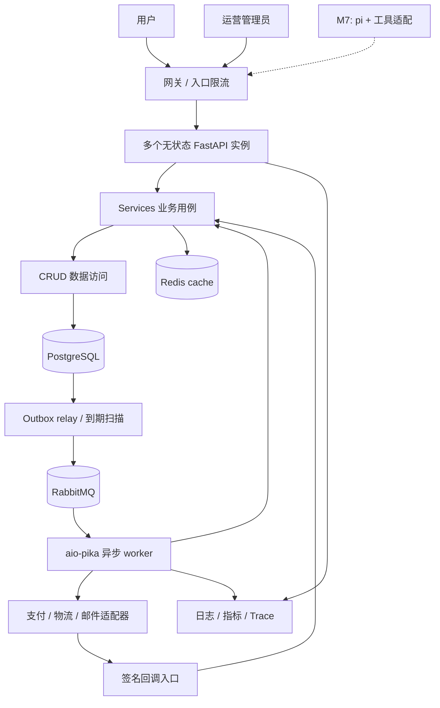

# A-commerce 总体架构决策

状态：已据此完成后端首版；实际范围与偏差见 [实施记录](backend-implementation.md)。优先交付后端，以 1 万并发在线用户为容量目标；pi 接入延后到 M7。负载定义与资源预算见 [capacity-plan.md](capacity-plan.md)。

后台任务采用 RabbitMQ + aio-pika，原生异步 worker 调用现有 service；Redis 只用于缓存和限流。任务执行、重试和恢复由本项目明确实现，不再依赖任务框架。

## 1. 产品与部署形态

目标是可维护、可验收的单商家电商后端，先服务普通用户和管理员，后续向 pi Personal Agent 开放同一套业务能力。v1.0 单仓、CNY、实物数码配件；不设计平台级多商户结算。

采用模块化单体：一份 Python 代码和一套 PostgreSQL 业务数据库，按进程部署 API、异步 worker 和调度器。多进程不等于微服务，各进程复用相同 service 和数据模型。



PostgreSQL 保存订单、资金操作、库存、授权和事件的事实。Redis cache 只缓存可重建数据；RabbitMQ 负责任务传递，发布确认和消费 ack 都不直接表示订单已支付或已退款。

## 2. 延续新闻项目的目录

```text
A-commerce/
  pyproject.toml / uv.lock / .python-version
  README.md
  docs/
    architecture.md / features.md / dependencies.md / capacity-plan.md
    mvp-plan.md / pi-integration.md / reference-review.md
  src/a_commerce/
    main.py                  # create_app、lifespan、挂载路由
    conf/
      settings.py            # 环境、连接、超时、业务参数
      db.py / redis.py / http.py / amqp.py
    routers/
      customer/              # auth、catalog、cart、checkout、orders、returns
      admin/                 # catalog、inventory、fulfillment、aftersales、reports
      agent/                 # M7 再创建：actions、events、grant 检查
      callbacks/             # 支付/物流原始回调
      health.py
    services/
      identity.py / catalog.py / cart.py / pricing.py
      checkout.py / inventory.py / orders.py
      payments.py / fulfillment.py / aftersales.py
      events.py / notifications.py / reporting.py
      operations.py          # 操作租约、重试安排、失败隔离与人工恢复
      actions.py             # M7 再创建：Agent 批准与执行
    crud/                    # 同业务命名，SQL/ORM 查询与写入，不 commit
    models/                  # ORM、约束、索引；base.py
    schemas/                 # 请求/响应、分页、事件、工具对应契约
    policies/                # 可独立解释的定价、售后、授权规则
    cache/                   # cache-aside、版本化 key、TTL、失效
    integrations/
      payments/              # provider 接口、模拟实现、未来沙箱实现
      shipping/ / storage/ / mail/
    messaging/
      envelope.py            # 版本化 JSON 消息，校验字段与大小
      topology.py            # exchange、queue、binding 与策略契约
      publisher.py           # mandatory、发布确认、失败报告
    workers/
      main.py                # 进程入口、连接生命周期、消费并发、退出
      handlers.py            # 按消息类型调用 service，不重复业务逻辑
    dispatch/                # outbox relay、到期扫描、租约管理
    observability/           # 结构化日志、metrics、tracing
    utils/                   # 纯通用函数；不承载业务编排
    dependencies.py          # Principal、权限、资源注入
    errors.py                # 业务错误到 HTTP 的映射
  alembic/                   # 迁移，每次发布只有一个迁移执行者
  pi-adapter/                # M7 再创建：独立 TS 包，HTTP 工具与调用状态
  scripts/                   # 管理员初始化、导入、维护命令
  deploy/                    # Compose、网关与监控配置
```

以上为规划结构，实际代码位置见实施记录；未批量创建空目录、空类或抽象基类。复杂模块增大后可以把 `services/orders.py` 拆成包，不提前套用多层 DDD 框架。

## 3. 层级约束与事务

调用方向：`router → service → crud → model/database`。schemas 约束输入输出，policies 表达不依赖 HTTP 的业务规则，integrations 隔离外部系统。

- router：解析参数、鉴权、调用用例、按 schema 返回结果；不写订单状态机。
- service：组织一个业务用例，定义事务、调用多个 CRUD、记录审计与 outbox。
- CRUD：接收显式 session，返回 ORM/查询结果，允许 flush；不 commit，不调用 HTTP，不决定退款资格。
- worker handler：校验版本化消息，按业务 ID 调 service；持久化处理结果后确认消费，不重复实现业务。
- 接口与 worker 不跨模块改写其他模块的表，跨业务操作由一个编排 service 统一负责。

公开商品浏览不查询会话。私人接口鉴权使用短读会话，输出不可变 Principal 数据，不把带 session 的 ORM 用户对象传入用例。业务 command service 创建独立 AsyncSession 并显式 `begin`，在这个事务内重新验证关键授权/账号状态；查询 service 使用自己的短读会话。鉴权查询计入容量预算，不能通过跳过权限或延迟撤销制造吞吐成绩。

嵌套业务步骤复用外层 session，不再 begin/commit。数据库 commit 在成功响应之前结束；依赖清理只关闭资源，不能承担响应后的隐式提交。

API lifespan 管理池化 AsyncEngine、Redis 和 HTTPX client，各池有明确上限，预算覆盖全部进程和发布重叠期。一个 AsyncSession 不在并发 task 间共享；固定锁顺序，按稳定 SKU 顺序锁库存，死锁/序列化失败只有限重试整个事务。外部 HTTP 不进入事务，连接池和锁等待不得无限排队。

### 原生异步 worker 的资源边界

worker 是独立 Python 进程，入口只运行一次 `asyncio.run(main())`。同一个长期运行的事件循环管理 aio-pika robust connection、AMQP channel、AsyncEngine 和 HTTPX client；handler 直接 `await` service。每条消息使用独立 AsyncSession 和 trace context，不跨进程/事件循环共享连接。

使用有界消息处理并发和 AMQP prefetch，按进程汇总多个 consumer 的上限，避免不断创建等待中的 task。每条消息独立处理异常，单条业务失败不取消其他正在处理的消息。图像、同步 SDK 和 CPU 密集任务放到有界执行器或专用 worker，不阻塞消费循环。

退出时先停止新消费和自动恢复订阅，再有界等待正在执行的任务，最后关闭 AMQP/HTTP/DB 资源；超时关闭 channel，未 ack 消息允许重新投递。取消本地等待不代表外部副作用已回滚。robust connection 可以恢复连接和声明，但不能确定断线前的发布或业务操作是否成功；旧 channel 上的消息不能在新 channel 上 ack。[aio-pika 生命周期说明](https://docs.aio-pika.com/quick-start.html#messages-interrupted-by-a-disconnection)、[SQLAlchemy 会话与循环限制](https://docs.sqlalchemy.org/en/20/orm/extensions/asyncio.html)

## 4. 数据模型与一致性

核心实体：

- 身份：users、staff、sessions、roles、role_permissions、addresses。
- 商品：categories、brands、products、skus、product_media、price_versions。
- 购买：cart_items、favorites、quotes、quote_items、orders、order_items、order_events。
- 库存：stock_items、stock_reservations、stock_movements。
- 支付：payment_intents、payment_attempts、provider_events、refunds、refund_items、reconciliation_runs。
- 履约售后：shipments、shipment_events、return_requests、return_items、return_inspections。
- 治理与恢复：idempotency_records、audit_events、outbox_events、event_deliveries、notifications、async_operations、message_failures。
- M7 扩展：agent_grants、actions；不提前成为普通交易的依赖。

金额统一整数分，数据库使用足够范围的整数类型；所有计算由后端完成。时间使用 timezone-aware UTC；业务展示使用用户时区。历史订单保留商品、价格、运费、政策版本与地址快照。

库存采用 `available = on_hand - reserved - allocated`：reserved 是待支付占用，allocated 是已支付待发货占用。数据库约束确保各值非负且合计不超 on_hand；每次变更有唯一业务流水引用。

| 动作 | 库存变化 |
|---|---|
| 创建待支付订单 | reserved 增加 |
| 支付确认成功 | reserved 转 allocated |
| 确认未支付关单 | reserved 释放 |
| 已支付且可取消 | allocated 释放，退款单独跟进 |
| 发货 | allocated 和 on_hand 同量减少 |
| 退货验收为可再次销售 | on_hand 增加一次 |

不使用 Redis 分布式锁作为库存正确性的唯一保障。最终价格、授权和库存校验基于 PostgreSQL；库存使用带可售条件的原子更新或行锁事务，价格变更与下单使用一致的版本/锁协议。热点 SKU 有限排队、短锁等待和限频，不能靠无限重试提高成功率。

## 5. 交易状态与外部副作用

订单业务状态、支付状态、履约状态、售后状态分别保存；“申请已受理”“订单已创建”“已支付”“已退款”不能互相代替。

### 5.1 确认后下单

报价有 10 分钟有效期，不预留库存；记录 SKU/价格/地址/运费与政策版本。买家确认后调用 `POST /api/v1/customer/orders`，传 quote_id 与幂等键。service 在一个事务中核对会话/归属、报价、价格与库存，创建 `pending_payment` 订单、库存预留、payment_intent、幂等结果、审计与 outbox。相同报价只创建一张订单；同键异参返回冲突。

事务提交后才调用支付提供方。接口返回 201、“订单已创建，待支付”及本站可信支付入口；如果提供方会话尚在创建，入口显示准备中并查询同一个 payment_intent，不能生成第二笔支付。Agent 接入后通过独立批准的 action 调用同一交易用例，并将 action 结果加入同一事务；普通购买不依赖该流程。

支付提供方通过回调或主动查询确认成功后，新的数据库事务转换预留库存、更新订单与支付状态，记录事件。模拟提供方使用独立存储和 HTTP 边界，复现同样的异步流程。

回调先按原始请求体验签、检查时间窗口和提供方事件 ID，再校验商户/订单关联、金额和币种，持久化后按状态机处理。重复事件返回已受理；旧 pending/failed 事件不能覆盖已确认成功。支付状态 unknown 时不得创建新的支付意图；额外成功收款必须形成对账差异和唯一退款，不能重复确认订单。

### 5.2 到期关单、取消与支付竞态

待支付默认 15 分钟到期，数据库保存 expires_at。扫描器将订单转 `closing`，发起关闭支付会话和核对；不能仅凭本地超时释放仍可能被扣款的订单库存。

- 本地可证明支付请求尚未发出且已禁止发送，或提供方确认支付会话已终态关闭：释放 reserved，订单 cancelled。仅查询到“当前未付款”不足以证明稍后不会付款。
- 提供方在 closing 阶段确认已付款：不继续履约，创建唯一补偿退款并取消订单、释放占用。
- 提供方结果未知：保留占用并告警，进入人工核对；不伪装成未付款。
- 已取消订单收到迟到成功：记录真实收款并生成唯一补偿退款，不恢复订单或重新抢库存。
- 已支付订单只有未进入拣货/发货时可取消；取消和履约操作锁同一订单，防止并发冲突。

支付提供方支持何种关闭与幂等语义必须由适配器显式说明。没有相应能力时保守核对，不宣称跨系统 exactly-once。

### 5.3 退款与退货

已成功退款额 + 所有处理中占用额（包含本次申请）不得超过已确认实付额，同时受订单行可退数量与运费政策约束；按支付记录锁定校验。每次退款拥有稳定业务操作 ID，不因网络失败更换 ID。已发货退货在收件验收后才能增加可售库存。

v1.0 支持按订单行/数量部分退货退款，按成交行金额核算；运费按订单快照政策只退一次，不能随每次部分退货重复退。换货在后续版本实现。

网络超时进入 unknown，先按提供方操作 ID 查账；确认成功则补记，确认未发生且允许重试才以同 ID 再发。数据库行锁无法回滚外部扣款，这部分必须依靠幂等、回调和对账。

## 6. Outbox、RabbitMQ 与任务恢复

### 6.1 消息与队列

通过 AMQP 0-9-1 使用 RabbitMQ。定义 durable direct exchange `commerce.commands.v1`，按 payment、refund、order.expire、reconciliation、notification、media、export 等明确 routing key 绑定独立队列。同一个队列的多个 consumer 分摊任务；需要多个业务订阅者时分别创建队列，不把竞争消费当广播。

业务队列采用 durable quorum queue、非 exclusive、非 auto-delete，消息标记 persistent。开发可使用单节点做功能联调；高可用部署采用三个独立故障域节点及三副本，并单独验证失去一个节点后的行为。单机多个容器不等于主机故障隔离。[RabbitMQ quorum queue](https://www.rabbitmq.com/docs/quorum-queues)

消息使用有大小上限的 JSON，字段包括 schema_version、message_id（outbox ID）、operation_id、operation_type、dispatch_version 和 trace context；不放凭证、ORM 对象或整张订单。类型来自 allowlist，业务参数从数据库读取并校验；不能按消息内容动态导入或执行任意函数。

每次业务操作的 operation_id 稳定；一次 outbox 发布重试沿用原 message_id。业务重试创建新的 dispatch_version 和对应 outbox，命令投递记录对 `(operation_id, dispatch_version)` 去重，业务事件独立按 event_id 标识。AMQP delivery tag 仅用于当前 channel 的确认，不能作为业务幂等键。

### 6.2 发布与 Outbox

业务事务同时写入订单/资金等记录、async_operations 与 outbox。relay 用短事务和租约领取记录，事务外发布，再用短事务记录发送结果；等待 RabbitMQ 不占数据库事务。

发布 channel 显式启用 `publisher_confirms=True`、`on_return_raises=True`；消息使用 `mandatory=True`。只有收到正向确认且没有不可路由退回，才标记 outbox 已发送。nack、退回、超时和断线均保留待核对/重发状态，有限退避，不把“调用 publish 未报错”直接当成功。[RabbitMQ 发布确认](https://www.rabbitmq.com/docs/confirms)、[aio-pika 发布 API](https://docs.aio-pika.com/apidoc.html#aio_pika.Exchange.publish)

确认丢失或发布成功后本地标记失败会造成重复；消费端必须幂等。`connect_robust` 恢复连接不等于自动可靠重发全部未确认消息，relay 仍按数据库记录补发。发布确认只证明 broker 接收消息，不证明 worker 已处理。

### 6.3 消费确认与租约

consumer 使用手动 ack；处理前用短事务领取 async_operations 的租约，递增执行 fence。外部调用在事务外执行，写回时检查 fence，过期 worker 不得覆盖新结果；外部副作用由稳定提供方操作 ID 去重。

| 处理情况 | 持久化与 ack 规则 |
|---|---|
| 业务完成 | 提交结果/业务事件后 ack；ack 丢失后的重复消息读取已有结果后 ack |
| 可以重试 | 先提交 retry_wait、next_attempt_at 和错误摘要，再 ack；扫描器到期生成下一次 outbox |
| 外部结果未知 | 先提交 unknown 与核对安排，再 ack；后续先查提供方，不直接重复扣款/退款 |
| 已终态、旧 dispatch 或已有有效租约 | 确认数据库状态后跳过并 ack；租约持有者崩溃由扫描器恢复 |
| 无法读取/提交数据库 | 不 ack；暂停消费、退避并在需要时关闭 channel，由 broker 重投，避免紧密重入队 |

正常 ack 表示本次消息对应的处理结果或后续恢复责任已经持久化，未必表示整个业务成功。状态仍以 PostgreSQL 的 async_operations/支付/退款记录为准，不新增 MQ 结果库。

### 6.4 重试、失败隔离与调度

业务重试只由数据库 next_attempt_at/due_at 驱动，带最大次数、退避和抖动；不叠加 broker 延时重试链，也不靠长时间持有未 ack 消息等待到期。不可重试或次数耗尽进入 failed/manual_review 并告警；unknown 继续核对或转人工，不能仅凭次数耗尽记成付款失败。

无法解析、未知版本等毒消息先写 message_failures 有界诊断，再 `reject(requeue=False)` 进入隔离队列。配置 durable DLX、durable quorum 隔离队列、显式 delivery-limit，以及来源 quorum queue 的 `dead-letter-strategy=at-least-once` 和 `overflow=reject-publish`；部署核对策略、绑定实际生效，监控转移失败、容量和保留期。不能假设默认死信转发永不丢失。人工重放需核对业务状态并留审计，不直接无限循环原消息。[RabbitMQ 死信规则](https://www.rabbitmq.com/docs/dlx)、[quorum 安全死信配置](https://www.rabbitmq.com/docs/quorum-queues#activating-at-least-once-dead-lettering)

隔离队列也可能收到因 broker delivery-limit 被移入的消息。通用 worker 中的受限隔离消费者只持久化诊断，不执行业务：对照原 outbox 的 message_id、内容和当前 dispatch，才可将对应未结束操作置为 manual_review；旧消息不覆盖新版本或已完成结果。数据库提交后再 ack 隔离消息，避免自动补发与隔离形成循环；其连接和并发计入通用 worker 预算。

支付/退款、关单/核对与通知/媒体/导出预留不同消费并发；提供方有全局速率预算。调度器使用数据库行租约选主，扫描待重试、未完成和租约过期的操作。即使 outbox 已标记发送，也要按业务状态和投递超时恢复，不能只扫描未发送 outbox。failed/manual_review 不自动重新执行；毒消息导致的已知操作要阻断自动补发并进入人工处理。

### 6.5 用户事件与顺序

outbox 中的事件对外以每用户事件流投影提供游标。投影事务锁定该用户序列记录后分配序号并插入事件，防止数据库自增 ID 提前分配但晚提交造成游标漏读；投影按源 event_id 去重。事件携带订单等实体的版本，投影到达顺序不冒充业务发生顺序，客户端不能用旧事件覆盖新状态。多个 consumer 和消息重投也不能用来保证同一订单的业务顺序，仍以状态机和版本校验为准。

## 7. 权限与 API 规范

沿用服务端 Token 思路：高熵随机 opaque token，数据库只存摘要和过期/撤销信息。用户登录、staff 会话分开建模；不因为成熟度要求就引入 JWT 或完整 OAuth 服务。写请求在事务内校验会话撤销、账号状态、资源归属和参数版本。

管理员按 catalog、fulfillment、aftersales、audit 权限分权，退款权限不等于可修改商品。采用 Cookie 的客户端需要 CSRF 防护；令牌不能放入 URL/日志。

M7 再增加 Agent grant 与独立 human action approval。grant 绑定用户、scope、有效期、单笔订单总额上限和任务范围；不向模型提供 human/admin 凭证。累计预算若加入，需要事务内占用/释放，不能依赖模型记忆。详细未来契约见 [pi-integration.md](pi-integration.md)。

API 前缀 `/api/v1`，先提供 customer、admin、callbacks；M7 增加 agent 路由。响应由 Pydantic 明确建模，不直接序列化 ORM；错误保留稳定 code、message、request_id、retryable 和有限 details。

创建返回 201，异步受理返回 202，状态/幂等冲突返回 409，校验 422，缺少认证 401；无权读取的私人资源统一 404。幂等键按用户/动作类型隔离，同键异参拒绝；超时首先查已有业务结果。

订单列表/事件采用游标分页，管理报表可受限分页；排序有唯一 ID 作为次级键。所有查询有数量、日期范围和耗时上限。

## 8. 缓存与资源

Redis cache：分类、商品展示、热点检索和限流计数；key 包含排序、筛选、分页、语言及 schema/商品版本，TTL 带抖动。更新后事务内写失效事件，relay 异步清理；关键交易不读缓存值。

热点缓存加入请求合并、短空值缓存与失效抖动。缓存失败可回源数据库，但限制并发；超出预算明确降级/拒绝。登录/发码等敏感接口的限流存储故障采用拒绝或网关兜底，不静默取消保护。Redis 仅用于缓存/限流，消息由独立 RabbitMQ 管理；分别配置资源、持久化与故障告警。

订单采用稳定游标和匹配过滤/排序的复合索引，避免 N+1 与大 OFFSET；报表采用汇总表与有界异步导出，不和下单争抢长事务。商品媒体由存储/CDN 提供。连接、查询和热点的详细预算见容量计划，PgBouncer/读副本按瓶颈与兼容性验证后引入。

媒体通过存储适配器：开发本地文件，部署 S3 兼容存储。生成受限上传 URL，校验用户/对象归属、大小、MIME 与真实图像解码，上传完成后才关联商品。同步 boto3/Pillow 工作放入受限线程或 worker，不阻塞 API 事件循环。第一版不接任意远程 URL 抓取。

## 9. 可运维要求

- 配置：Pydantic Settings，环境覆盖根目录开发 `.env`；启动时检查必填配置；示例文件不写真实凭证。
- 生命周期：连接池预算按所有 API/worker/扫描/运维进程及发布重叠合计；超时、退出宽限期与任务时间上限协调。API 无状态，扩容不能突破主库连接预算。
- 部署：API、worker、relay/scheduler、migrate 使用同一镜像和不同入口，由容器/进程管理器重启进程；数据库/Redis/RabbitMQ 内网。MQ 独立 vhost、按角色授权，部署使用 TLS 与受限管理端口。生产镜像非 root，关闭 reload，资源与文件权限明确。
- 健康：liveness 只判断进程；API readiness 核对数据库与迁移版本，worker 额外检查 AMQP channel/consumer 是否可用；缓存/队列降级单独报告。broker 不可用时 outbox 暂存并受积压准入门槛约束。
- 观测：structlog JSON 日志、Prometheus 指标、可选 OTel trace；request_id → order_id → operation_id/message_id 全链路关联，M7 补充 action_id。覆盖发布确认延迟/退回、ready/unacked、重投、隔离队列、业务重试、最老操作年龄和 broker 磁盘/内存告警。多进程指标正确聚合，高基数 ID 不作为指标 label。
- 审计：业务审计与普通日志分离，限制更新/删除权限；记录主体、授权、前后状态、结果，不记录 token、完整地址或模型隐藏推理。
- 恢复：数据库备份与异机恢复演练、迁移前备份/恢复步骤、消息重投、资金差异处理手册。删除业务数据先定义保留期，不用日志清理代替业务归档。
- CI：依赖冻结安装、格式/静态检查、迁移检查、真实 PostgreSQL/Redis/RabbitMQ 集成验证、关键并发与故障场景、OpenAPI 契约变化检查、依赖审计。测试代码待相应实施请求授权后创建。

容量验收目标为 1 万活跃在线用户，按混合路径运行并同时核对交易、队列和资源。所有吞吐量、SLO、恢复时间都是待测目标。通过 lint 或依赖解析不能表述为生产可用。
