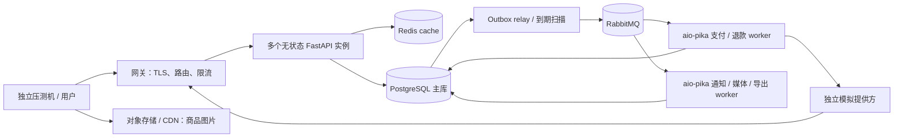

# 1 万在线用户的容量与验收计划

2026-10-25 工具进展：已加入独立用户数据生成、固定用户数/路径到达率负载工具及小规模冒烟，使用方法见 [本地后端回归与验收](backend-validation.md)。下文的“尚未压测”指正式容量目标尚未验收。

状态：容量设计目标；后端首版已实现，尚未压测。用户确认的口径是 **1 万同时在线、持续浏览与下单的用户**；不是 1 万 QPS、1 万下单 TPS，也不是 1 万条空闲连接。Agent 在后端验收之后接入，不计入本阶段负载。

## 1. 先固定负载含义

| 指标 | 本项目含义 |
|---|---|
| 在线用户 | 10,000 个独立虚拟用户，有会话、浏览路径、思考时间和后续操作；不只保持连接 |
| QPS/RPS | 每秒到达后端的 HTTP 请求数；商品图经对象存储/CDN，单独统计 |
| 在途请求 | 某一时刻尚未完成的 HTTP 请求，不等于在线人数 |
| 下单 TPS | 每秒成功提交的唯一订单数；幂等重放、202、失败和支付成功分别计数 |
| 后台负载 | 订单触发的支付、回调、通知、到期扫描、对账等，必须与前台流量一起运行 |

初始估算：若每名用户平均每 5 秒产生一个 HTTP 请求，10,000 / 5 ≈ 2,000 RPS。如果这是一个包含 3 个请求的页面操作，则约为 6,000 RPS。实际值取决于接口调用数、停留时间与轮询频率，不能直接用人数换算容量。

目前没有真实流量样本，先使用以下**待校准假设**，以后用前端请求轨迹或访问日志替换。比例按客户 HTTP 请求计，不含提供方回调、后台任务和静态媒体：

| 请求类别 | 初始比例 | 2,000 RPS 下的说明值 |
|---|---|---|
| 公开目录：列表、筛选、搜索、详情 | 85% | 1,700 次/秒 |
| 私有查询：购物车、地址、订单/支付状态、通知 | 10% | 200 次/秒 |
| 购物车修改、生成报价等普通写请求 | 4% | 80 次/秒 |
| 确认报价并创建订单 | 1% | 20 次尝试/秒；成功 TPS 另计 |

脚本将来应执行完整用户路径：浏览 → 选 SKU → 购物车/报价 → 部分用户下单 → 部分付款/放弃 → 查询结果。上表是这些路径产生的汇总目标，不是独立随机调用接口。付款、放弃、取消的比例和模拟提供方延迟必须随报告保存。

第一轮使用每次业务操作之间 3–7 秒的均匀思考时间，固定一次操作对应的 HTTP 请求数，再据此设置到达率目标。响应耗时仍计入实际用户循环；每次操作若只有一个请求，初始到达率目标可取约 2,000 RPS。此模型是待校准的工程假设，不能称为真实用户统计，也不能在压测失败后临时加长思考时间来维持“1 万在线”的数字。

登录在预热阶段完成，正常期间保留会话更新；额外评估集中登录，不能让每次浏览都重新做 Argon2。每个用户拥有独立数据，禁止所有用户共享同一购物车或令牌。

## 2. 部署基线

- 保留模块化单体；API 无本地会话和业务状态，可增加实例。开发用 Compose；容量验收分开记录 API、数据库、worker、Redis、RabbitMQ 和压测机的资源。
- 网关管理客户端 keep-alive、请求体大小和入口流量；限制上游连接和正在执行的请求。图片下载、导出文件不经过 Python 业务进程。
- 回调使用独立路由和并发预算；若浏览压力仍会挤占回调，再从同一镜像部署专用回调实例，并加入连接预算。
- Redis 只承担缓存与限流；RabbitMQ 独立部署。业务队列采用 durable quorum queue，持久消息、发布确认和手动 ack；队列容量上限与 `reject-publish` 配合，避免积压时静默丢弃旧任务。业务恢复仍依赖 PostgreSQL。
- RabbitMQ 开发单节点与高可用部署分开记录；三节点三副本方案需要独立故障域，并计入复制带来的磁盘与网络成本。单节点性能记录不能作为 broker 高可用证据。
- 一主库是当前容量基线，不等于数据库高可用。生产可用性、主库故障切换与灾备需要单独目标和演练，不能由“1 万在线”推导。

此时不指定“一台某配置必然足够”。正式运行前固定 CPU、内存、磁盘、网络、容器限额、软件版本与部署位置；本机 macOS/Docker 的结果只代表该环境。

## 3. 连接和资源预算必须全局计算

1 万用户共享有限数据库连接。每个进程各有连接池；扩实例、加 worker、滚动发布都增加总连接数。

以下只作为**第一轮配置示例**，不是已经证明能达到目标的配置。SQLAlchemy 直接连接 PostgreSQL，每个池 `max_overflow=0`：

| 使用者 | 数量 × 单进程池上限 | 最大连接预算 |
|---|---|---|
| API | 2 个实例 × 2 个进程 × 5 | 20 |
| 异步 worker | 关键/通用各 1 个进程 × 池上限 4 | 8 |
| relay / scanner | 2 个进程 × 2 | 4 |
| 运维、迁移、监控及临时查询 | 预留 | 8 |
| 正常合计 | | 40 |
| API/worker 发布时新旧进程重叠 | 额外预留 20 + 8 | 28 |

若示例数据库 `max_connections=100`，上述最高预算为 68，剩余 32 为保留连接及其他安全余量。新进程类别、自动扩容和发布最大重叠数都要重新计入；不能只配置单个 API 池。

worker 的协程并发与数据库池大小分别配置，例如每进程处理并发 8、数据库池 4：只有进入短数据库步骤时才占连接，等待提供方 HTTP 时不占用。多个 consumer 的 prefetch 与应用总并发统一预算；不能每个队列都独立开满后把上限相乘。

AMQP 连接单独计算：上述两个 worker 各一条消费连接，relay 一条发布连接，常态共三条；新旧进程完全重叠为六条，再预留维护额度。API 只提交数据库 outbox，不为每个 HTTP 请求或在线用户建立 MQ 连接。channel 数、未确认发布窗口、消息大小、发布超时与连接重试同样有上限。

平均活跃数据库连接可粗估为“每秒数据库事务数 × 平均持有连接秒数”，但还要留突发余量。例如 300 个事务/秒、每个占用 20ms，平均约 6 条活跃连接；若在事务内等待 500ms 外部 HTTP，则该项变成 150 条。这只是预算说明，实际以池等待、SQL 和锁等待观测为准。

具体约束：

- 外部 HTTP、对象存储、邮件和用户思考时间均不占数据库事务；查询取完结果即释放会话，避免 ORM 懒加载拖长连接生命周期。
- 显式设置连接池等待、数据库语句/锁等待、HTTP 连接/读取和请求总超时。内部等待先结束，才能在网关超时前返回清楚的结果；未知资金结果仍需核对。
- Redis 与 HTTPX 同样设置连接池上限。CPU 密集的密码验证、图像处理和大导出使用有界线程/worker；排队也有上限。
- 过载时返回 429/503 和可重试信息，客户端退避；不无限积压。不对未知结果的写请求自动换幂等键重试。
- Uvicorn 的 `limit-concurrency` 同时涉及连接/任务，达到限制会返回 503；需结合上游 keep-alive 实测，不能直接填成在线人数或数据库池大小。[官方参数说明](https://uvicorn.dev/settings/)

### PgBouncer 的引入门槛

基线先使用 SQLAlchemy 有界直连池。当多副本/短事务导致连接管理成为瓶颈时，再加入 PgBouncer transaction pooling，并重新划分客户端连接与 PostgreSQL 后端连接预算。

这不是透明开关：必须固定 PgBouncer 版本，并验证 SQLAlchemy + asyncpg 的 prepared statement、DDL 后缓存失效、连接重置和迁移行为。新版本 PgBouncer 可在相应配置下追踪协议级 prepared statements；不能只写“关闭缓存即可”。SQLAlchemy 也有 NullPool 与连接重置建议，应按最终组合实测决定，不叠加无界双层池。[PgBouncer 特性表](https://www.pgbouncer.org/features.html)、[SQLAlchemy asyncpg 说明](https://docs.sqlalchemy.org/en/20/dialects/postgresql.html#prepared-statement-name-with-pgbouncer)

transaction pooling 不保证会话级状态。调度选主用数据库行租约；迁移/维护按需要使用独立直连。PgBouncer 不提升慢 SQL 或热点库存行本身的执行能力。

## 4. 读路径：缓存命中之外，还要控制缓存失效

- 公开商品浏览不查用户会话；私人查询必须鉴权。v1 保留服务端会话与账号状态的数据库校验，并计入负载，不靠延迟撤销换取成绩。
- 分类、详情、常用筛选结果采用 cache-aside；缓存 key 覆盖分页/排序/筛选/schema 版本，返回展示 DTO。购物车、地址、订单不能进入共享公共缓存。
- TTL 抖动、热点请求合并、短期空结果缓存、查询参数上限共同防止大量请求同时回源。非热点搜索不能无限创建缓存 key。
- 允许的商品展示陈旧时间需可配置并记录；价格、上下架、库存和地址在报价/下单时再次核对。缓存中的“有货”不代表已占用库存。
- 缓存故障时限量回源；有已知安全旧副本时只对允许陈旧的公开展示降级，其他请求明确失败。不能把全部流量直接压向数据库。
- SQL 只选需要的列；批量查询避免 N+1；订单使用 `(user_id, created_at, id)` 等匹配过滤与排序的索引，扫描器使用匹配状态/到期时间的索引。最终索引以实际 SQL/执行计划确定。
- 大列表用稳定游标，搜索词/筛选项/返回条数有上限；不默认每页做全表精确计数。报表从增量汇总表读取，重导出走低优先级任务，避免实时全表聚合争抢交易资源。
- 先优化主库查询；读副本只有在读成为实测瓶颈时引入。用户刚下单后的查询仍保证读到自己的写入，不把复制延迟当成订单丢失。

## 5. 写路径：把一致性与热点冲突做实

用户确认报价后直接 `POST /api/v1/customer/orders`，提供 quote_id 和幂等键。事务核对会话、报价与价格版本，按稳定 SKU 顺序执行带可售条件的库存更新/加锁校验，写订单、预留、支付意图、幂等结果、审计和 outbox 后提交。

相同报价只产生一张订单，同一用户/操作的同键异参冲突；任何 SKU 失败回滚整单。订单及库存存在数据库约束和唯一业务流水，不能仅靠“先查剩余库存，再无条件扣减”。并发涨价/上下架与下单按一致的版本/锁协议协调，不能只在事务开始前查一次价格。

最后一件商品必然存在竞争；1 万普通在线用户与 1 万人同时抢一个 SKU 是不同负载，分别报告。首版保留 PostgreSQL 作为库存事实，热点 SKU 加用户限频、并发上限、短锁等待和有限重试；不直接引入 Redis 预扣库存或分库分表。

订单创建同步返回实际已提交的订单，支付会话在后台准备；不能为了低延迟把所有下单请求改为 202 后计成成功 TPS。普通用户确认报价即可购买，Agent 的 grant/action 在 M7 增加。

## 6. 后台任务也必须有容量

- 支付/退款、到期关单、通知、媒体/导出按任务类别路由并预留消费并发；慢导出不能堵住退款。broker 共用不表示必须由同一 worker 消费。
- aio-pika worker 每个进程只启动一个长期运行的事件循环，复用 AMQP、AsyncEngine 与 HTTPX 资源；消息 handler 直接 await service，每次处理独立 session。进程由部署管理器启动/重启。
- task 之间隔离 trace context，限制同时运行和等待的处理数量。退出先停止新消费再有界等待，未 ack 消息允许重投；旧 channel 的 delivery 不能在重连后的新 channel 上确认。强制停止依靠租约、幂等和资金核对恢复。[aio-pika 消费与重连](https://docs.aio-pika.com/quick-start.html)
- prefetch 限制尚未确认的投递数，应用并发限制实际执行数；处理结果或下一次核对/重试安排持久化后才 ack。对提供方的全局并发/速率有独立预算，不能只限制单 worker。
- 正常重试采用数据库 next_attempt_at、有限次数、退避与抖动，不立即反复 nack/requeue；unknown 先查再重试。非法消息进入隔离队列，已知终态失败进入人工处理，重放需要审计。
- relay 等待正向发布确认且检查 mandatory 退回后才标记已发送；broker 断连、容量拒绝、确认超时会产生受控退避与 outbox 积压。恢复后按有界速率排空，不能瞬间向提供方放大流量。
- relay/扫描器按索引、批量和租约领取；多消费者可使用适合队列表的 `SKIP LOCKED`，普通库存判断不使用跳过锁行来隐藏竞争。
- 对账、事件投影、到期关单同样按批次处理，限制一次工作量；保留与清理规则覆盖 outbox、幂等记录、审计和历史任务。不能清掉仍可能被重试的幂等证据。
- 观测产生率、业务完成率、最老待处理年龄、租约超时和未知操作数。ack 速率不等于业务完成率：ack 前可能只提交了后续重试/核对安排。稳定流量下积压持续增加意味着未达到容量目标，即使 HTTP 全部成功也不通过。
- 关键任务积压或提供方持续不可用时，按预设门槛暂停接受新的结算/支付操作，保留查询、回调、退款核对和恢复通道；已创建订单按原状态机处理。门槛和恢复条件写入配置，避免不断受理订单耗尽库存与任务容量。

## 7. 待测服务目标

以下为首次验收目标，须在固定环境、上述负载、正常缓存与提供方可用条件下验证。延迟从压测端经过网关测量，按路由类别统计，不只测 service 函数：

| 类别 | p95 | p99 | 额外要求 |
|---|---|---|---|
| 公开目录查询 | ≤ 200ms | ≤ 500ms | 分开记录缓存命中/未命中与搜索 |
| 私有查询 | ≤ 400ms | ≤ 1s | 使用真实鉴权和目标数据量 |
| 创建订单 | ≤ 800ms | ≤ 2s | 已提交订单，不含用户支付时间；热 SKU 单列 |
| 系统失败 | — | — | 正常目标负载下 ≤ 0.1%，包含超时、5xx 和容量导致的 429 |
| 关键 outbox 从提交到 RabbitMQ 确认且已路由 | ≤ 2s | — | 最老可投递项 ≤ 10s；长期积压无持续增长 |

预设缺货/过期/权限拒绝单独统计；不能把所有 4xx 排除来掩盖业务失败。记录每条购买路径的完成率、创建订单数、支付终态和资金未知数量。提供方调用耗时、支付会话可用耗时、退款完成时间独立统计并保存模拟延迟配置，不能用 HTTP SLO 代替它们。

正确性是独立硬门槛：超卖、重复订单/扣款/退款、超额退款、已受理操作永久丢失均为 0。吞吐达到目标但正确性失败，整体不通过。

## 8. 验收方法与数据

只确定实施要求，本次不创建或执行压测脚本、测试数据或测试用例。

- 数据基线：至少 10,000 个独立活跃用户、10,000 个 SKU、1,000,000 条历史订单及对应订单行，包含冷热商品和不同订单状态。20 个演示 SKU 只用于功能演示。初始库存要足以覆盖正常购买，缺货竞争单独评估。
- 正常运行：分级升到 1,000 / 3,000 / 5,000 / 10,000 用户，记录开始出现排队或延迟突增的位置；10,000 用户至少稳定运行 30 分钟，再安排 2 小时持续运行观察内存、连接与积压增长。
- 用户模型：k6 固定/渐增 VU，保存思考时间分布、登录策略、浏览/下单路径和轮询间隔。10,000 空闲 VU 不算达标。
- 到达率模型：另外以记录下来的业务路径和请求到达率压测，并逐步提高到出现瓶颈。固定 VU 模式会因后端变慢而自动降低发送速率，单独使用会掩盖压力；同时检查 `dropped_iterations` 和压测机饱和情况。[k6 开放与封闭模型](https://grafana.com/docs/k6/latest/using-k6/scenarios/concepts/open-vs-closed/)
- 边界情况：分别记录缓存预热/冷启动、热点 SKU、集中登录、突发流量、缓存失效、worker 停止/恢复、RabbitMQ 断连/重启/确认丢失、隔离队列不可用、提供方变慢和 API/worker 滚动发布。高可用部署额外验证 quorum 节点故障。故障场景评价降级和恢复，不混入正常流量的延迟平均数。
- 故障结束后停止新增流量，继续核对未完成 operation、库存、支付和退款；记录积压排空时间。HTTP 压测结束不等于业务验收结束。
- 观测：API/worker CPU、内存、事件循环延迟，池等待、SQL/锁等待、Redis 命中、数据库 I/O；RabbitMQ 的连接/channel、ready/unacked、发布确认/退回、重投、隔离队列、磁盘/内存阻塞；以及业务操作完成率和压测端 CPU/网络/失败。Prometheus 必须覆盖全部 API/worker/broker，多进程部署按官方模式聚合，不能只采到随机一个进程。[Python client 多进程说明](https://prometheus.github.io/client_python/multiprocess/)

报告必须保存：代码/镜像/锁版本、硬件和网络、进程数与全部连接池、数据量与初始库存、流量分布、缓存状态、外部提供方行为、实际 RPS/TPS、p50/p95/p99、各类错误、业务核对、瓶颈与恢复时间。

只有报告证明之后，才可以写“在该配置与该负载下支持 1 万并发在线用户”。当前只有架构和验收计划。
